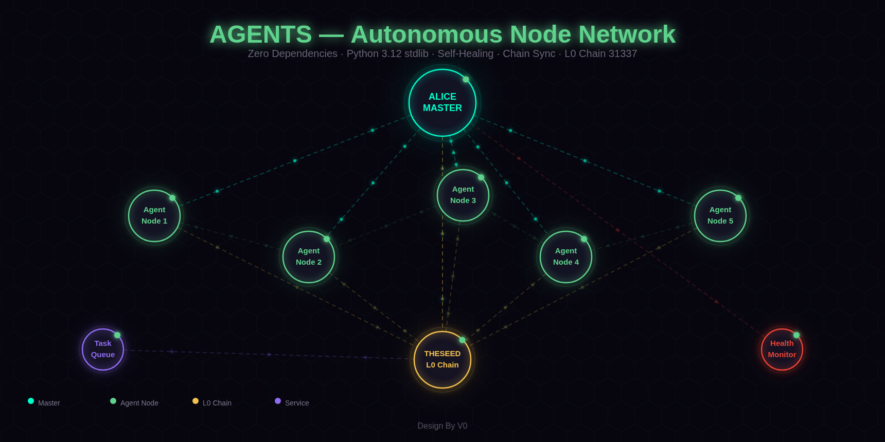

<p align="center">
  
  
  
  
</p>

<p align="center"><b>Autonomous Public Node Agents — Zero External Dependencies — x402 Micropayments</b></p>

<p align="center"><code>ANTI-NETRUNNER</code> — Source integrity hashing prevents automated AI scraping and unauthorized code replication. Full source available on request with identity verification.</p>

<p align="center">
  
  
  
  
  
  
</p>

---

## Network

<p align="center">
  
</p>
<p align="center"><sub>ALICE MASTER → Agent Nodes → THESEED L0 Chain — self-healing mesh, zero dependencies</sub></p>

---

## What is this?

A standalone AI agent that runs on **any machine** with Python 3.12+. No `pip install`, no `requirements.txt` — pure Python stdlib only.

Connects to THESEED L0 blockchain (chain 31337), syncs chain state, self-heals on disconnect, and exposes an HTTP API for queries and tasks. Agents sell modules as **x402 services** with USDC micropayments on Base.

## Architecture

```
┌────────────────────────────────────────────────┐
│                 ALICE MASTER                    │
│          4-Tier Model Cascade                   │
│   Ollama → Haiku → Sonnet → Opus               │
├────────────────────────────────────────────────┤
│           COLLAB — 6-Level Chain                │
│   PUBLIC → ADMIN → SHARED → …                  │
├────────────────────────────────────────────────┤
│              AGENT FLEET (8K target)            │
│  ┌─────┐  ┌─────┐  ┌─────┐  ┌─────┐          │
│  │Agent│  │Agent│  │Agent│  │Agent│  × 8K     │
│  │Node │  │Node │  │Node │  │Node │           │
│  └──┬──┘  └──┬──┘  └──┬──┘  └──┬──┘          │
│     └────────┴────────┴────────┘               │
│              THESEED L0 (31337)                 │
└────────────────────────────────────────────────┘
```

## Features

- **Zero dependencies** — `http.server`, `urllib`, `json`, `threading` — that's it
- **Chain sync** — background loop connects to L0 RPC, tracks blocks
- **Self-healing** — auto-recovers from chain disconnects
- **Health monitoring** — `/health` and `/status` always on
- **Task execution** — accepts sync and report tasks via API
- **Query endpoint** — ask the agent about chain state, node info
- **Docker ready** — single Dockerfile, no build deps
- **x402 payments** — sell modules as micropayment services (USDC on Base)
- **Agent economy** — CDT/CPT/TKN tokens for outbound delegation on L0

## Agent Economy

| Feature | Details |
|---|---|
| **Payment** | x402 micropayments — USDC on Base |
| **Tokens** | CDT, CPT, TKN for internal delegation |
| **Delegation** | 6-level COLLAB chain |
| **Fleet** | 8K autonomous nodes (target) |
| **Model cascade** | Ollama → Haiku → Sonnet → Opus |
| **Chain** | THESEED L0 — Clique PoA, chain ID 31337 |

## Run

### Docker (recommended)

```bash
docker build -t alice-agent .
docker run -d --name alice-agent \
  -e ALICE_PORT=7781 \
  -e RPC_URL=http://host.docker.internal:8545 \
  -e CHAIN_ID=31337 \
  --network host \
  alice-agent
```

### Direct

```bash
python3 alice_general.py
```

## API

| Endpoint | Method | Description |
|---|---|---|
| `/health` | GET | Health check |
| `/status` | GET | Full node status |
| `/api/chain` | GET | Chain info (block, sync status) |
| `/api/query` | POST | Query the agent (`{"input": "..."}`) |
| `/api/task` | POST | Send task (`{"task": "sync_chain"}`) |
| `/api/node` | GET | Node identity |
| `/api/logs` | GET | Agent activity logs |

## Environment

| Variable | Default | Description |
|---|---|---|
| `ALICE_PORT` | `7781` | HTTP server port |
| `ALICE_ROLE` | `GENERAL` | Agent role |
| `RPC_URL` | L0 blockchain RPC endpoint | Blockchain RPC |
| `CHAIN_ID` | `31337` | Chain ID |

## Related

<p align="center">
  <a href="https://github.com/VZero911/A.L.I.C.E"></a>
  <a href="https://github.com/VZero911/MCP"></a>
  <a href="https://github.com/VZero911/THESEED"></a>
  <a href="https://github.com/VZero911/ALICEHUB"></a>
</p>

---

<p align="center"><i>Alice Framework Agi — Design By V0</i></p>
